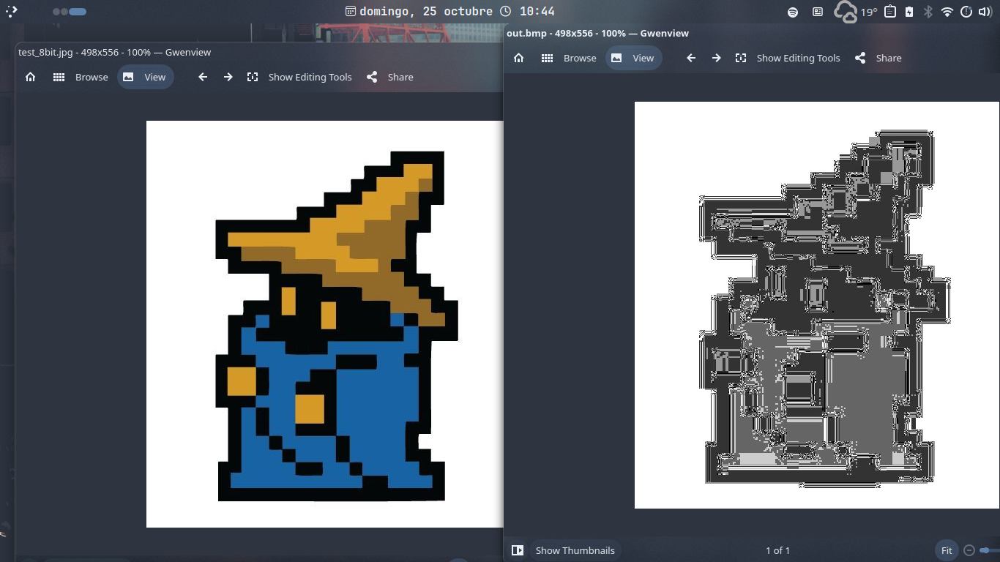

# Mina-IMG

## A simple image format that turns images into pixelated grayscale.
**This format isn't meant to be a replacement to BMP, PNG, and JPEG. I don't even know if it's practical for any real use, I just made this as a learning experience.
I will probably keep improving this and maintaining it. I have ideas on what to do next**

**Note: Conversion to and from WebP not supported yet**

## Example

### Requirements
- Have [Go](https://go.dev/) installed

### Project Setup:
- `git clone git@github.com:swampPr/mina-img.git`
- `cd ./mina-img`
- `go build`
- `go install`
- `mina-img --help`

### Basic Usage
- Encode an image to .mina:
    -`mina-img encode /path/to/source.bmp /path/to/out.mina`
- Convert .mina to BMP, PNG or JPEG:
    -`mina-img convert /path/to/source.mina /path/to/out.bmp`
